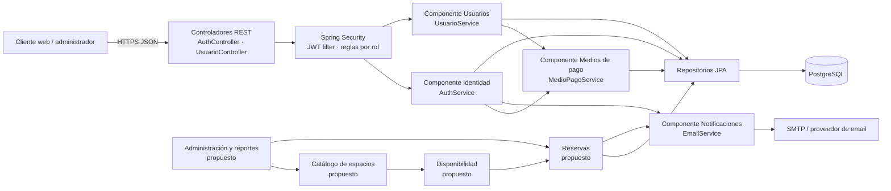

# Documento técnico — Planta Libre

**Sistema:** reservas de espacios · **Backend:** `back-daii` · **Versión:** 1.0 · **Fecha:** 17/09/2026

## 1. Propósito, alcance y dominio

Planta Libre es un sistema para que personas registradas puedan reservar espacios físicos. El backend existente implementa la base de identidad: alta y confirmación de usuarios, inicio/cierre de sesión con JWT, recuperación de contraseña, perfil, medios de pago y administración básica de usuarios. La evolución funcional propuesta incorpora el catálogo de espacios, disponibilidad, reservas y notificaciones asociadas.

El alcance técnico de este documento es un backend HTTP REST, desplegable como un único servicio Java/Spring Boot en un contenedor Docker, que persiste sus datos en PostgreSQL y se integra por SMTP para correos transaccionales. Se adopta inicialmente un monolito modular: las fronteras de componentes se expresan mediante interfaces y paquetes, pero el despliegue sigue siendo una unidad simple. Esto evita el costo operacional de microservicios para un producto de tamaño acotado y conserva una vía de extracción futura si la carga o la organización lo requieren.

### Justificación del dominio

El dominio de reservas de espacios sostiene de manera natural los requisitos técnicos del proyecto porque combina reglas de negocio no triviales, datos persistentes relacionados y escenarios de seguridad reales. Una reserva vincula un usuario, un espacio y un intervalo de tiempo; por lo tanto exige validar identidad, permisos, estados y ausencia de solapamientos. La consistencia de esas operaciones requiere transacciones y una base de datos relacional, en vez de limitarse a operaciones CRUD aisladas.

También permite justificar la separación de capas: la presentación recibe solicitudes HTTP, el negocio decide si un usuario puede reservar y el acceso a datos mantiene usuarios, recursos, pagos y reservas. La comunicación por correo tiene un uso concreto para confirmar cuentas, recuperar contraseñas y, en la evolución, notificar cambios de reserva. Finalmente, el dominio contiene rutas públicas sensibles —login, disponibilidad de email y recuperación— que hacen pertinente aplicar autenticación JWT, cifrado de contraseñas, rate limiting y autorización por rol. Así, las decisiones de arquitectura no son decorativas: responden a reglas, integraciones y riesgos propios de un sistema de turnos/reservas.

## 2. Arquitectura general

La aplicación sigue una arquitectura en capas dentro de un monolito modular. Cada solicitud atraviesa el filtro de seguridad y un controlador REST; este depende de una interfaz de servicio, cuya implementación ejecuta reglas y transacciones, y finalmente usa repositorios JPA para llegar a PostgreSQL. Los DTO delimitan el contrato de la API y evitan exponer entidades JPA.

**Dependencias permitidas.** La capa de presentación conoce interfaces de aplicación, nunca repositorios. Las implementaciones de servicios conocen contratos de persistencia e integración. Las entidades se concentran en `domain`; los DTO y el mapper cruzan la frontera HTTP. Esta dirección de dependencia permite probar reglas de negocio con sustitutos de repositorios y reemplazar el envío SMTP sin modificar autenticación ni controladores.

### Despliegue

El `Dockerfile` realiza una construcción multietapa: Maven con Eclipse Temurin 21 genera el JAR y la imagen final contiene solamente JRE 21 y `app.jar`. Expone el puerto 8080 y ejecuta `java -jar app.jar`. El archivo `render.yaml` declara un servicio web Docker llamado `planta-libre-api`, con health check en `GET /api/health` y configuración de secretos por variables de entorno (`DB_URL`, `DB_USERNAME`, `DB_PASSWORD`, `JWT_SECRET` y `MAIL_PASSWORD`). Por lo tanto, el componente de autenticación descrito en la sección 5 se despliega dentro de un contenedor real, no como una biblioteca o un prototipo local.

La base se configura mediante `DB_URL`; localmente su valor por defecto es `jdbc:postgresql://localhost:5432/reservas_espacios`. Flyway ejecuta las migraciones versionadas al arrancar y JPA usa `ddl-auto: validate`; este último ajuste impide que Hibernate altere el esquema de forma implícita.

## 3. Componentes candidatos e interfaces principales

Los siguientes son los componentes lógicos del sistema completo. Las firmas son **contratos de diseño**, deliberadamente sin implementación en esta sección. Los tres primeros y notificaciones tienen una implementación parcial o completa en el backend actual; catálogo, disponibilidad, reservas y reportes son la evolución propuesta.

| Componente | Interfaz principal (operaciones) | Responsabilidad |
|---|---|---|
| Identidad y acceso | `AuthService.registrar(datos)`, `iniciarSesion(credenciales)`, `confirmarEmail(token)`, `cerrarSesion(token)`, `recuperarClave(email)`, `restablecerClave(token, clave)` | Gestionar credenciales, ciclo de confirmación, tokens JWT y estado de sesión. |
| Usuarios y perfiles | `UsuarioService.obtenerActual(email)`, `actualizarActual(email, datos)`, `listar()` | Administrar el perfil propio y la consulta administrativa de usuarios autorizados. |
| Medios de pago | `MedioPagoService.agregarTarjeta(usuario, datos)`, `listar(usuario)`, `actualizar(usuario,id,datos)`, `marcarPrincipal(usuario,id)`, `eliminar(usuario,id)` | Mantener referencias de medios de pago del usuario; no procesar cobros ni almacenar datos sensibles completos de tarjeta. |
| Catálogo de espacios | `EspacioService.crear(datos)`, `actualizar(id, datos)`, `buscar(filtros)`, `obtener(id)`, `desactivar(id)` | Publicar recursos reservables con capacidad, ubicación, equipamiento, precio y estado operativo. |
| Disponibilidad | `DisponibilidadService.consultar(espacio,desde,hasta)`, `bloquear(espacio,intervalo,motivo)`, `liberar(bloqueo)` | Calcular franjas disponibles y administrar bloqueos operativos; es la única frontera que define si un intervalo puede ofrecerse. |
| Reservas | `ReservaService.crear(usuario,solicitud)`, `confirmar(usuario,id)`, `cancelar(usuario,id,motivo)`, `listarPorUsuario(usuario)`, `listarPorEspacio(espacio,rango)` | Orquestar el ciclo de vida de una reserva, comprobar disponibilidad de forma transaccional y registrar sus estados. |
| Notificaciones | `NotificacionService.enviarConfirmacion(destino,reserva)`, `enviarCambio(destino,reserva)`, `enviarRecuperacion(destino,enlace)` | Entregar comunicaciones del dominio aislando el canal concreto (SMTP hoy; API de correo mañana). |
| Administración y reportes | `ReporteService.ocupacion(rango)`, `ingresos(rango)`, `cancelaciones(rango)`, `AdministracionService.gestionarEspacio(id,accion)` | Exponer indicadores y operaciones restringidas para la gestión operativa. |

Los contratos devuelven DTOs o resultados de aplicación, no entidades JPA. En una siguiente iteración, `ReservaService.crear` recibirá un `CrearReservaRequest` con identificador de espacio y rango horario; la implementación deberá usar una transacción y una restricción/consulta de solapamiento para que dos solicitudes simultáneas no confirmen el mismo recurso.

## 4. Selección y justificación del stack

| Tecnología | Uso | Decisión de diseño |
|---|---|---|
| Java 21 | Lenguaje y ejecución | LTS actual en el proyecto; ofrece un ecosistema maduro, tipado estático y buen soporte de herramientas. |
| Spring Boot 3.3 | Servidor web y contenedor de componentes | Reduce configuración repetitiva, provee inyección de dependencias, validación, configuración externa y servidor embebido. |
| Spring Web + Validation | API REST | Permite expresar rutas, códigos HTTP y validación declarativa en DTOs antes de ejecutar negocio. |
| Spring Security + JJWT | Autenticación/autorización | JWT permite sesiones stateless en la API; filtros y `@PreAuthorize` centralizan y hacen explícitas las reglas de acceso. |
| Spring Data JPA / Hibernate | Persistencia | Repositorios tipados y transacciones simplifican el acceso a datos sin mezclar SQL con controladores. |
| PostgreSQL | Base relacional | Adecuada para relaciones usuario–reserva–espacio, restricciones de integridad, índices y transacciones requeridas para evitar solapamientos. |
| Flyway | Evolución de esquema | Las migraciones versionadas hacen reproducible el esquema entre desarrollo, prueba y producción. |
| MapStruct | Mapeo entidad/DTO | Genera mapeos en compilación, mantiene la API desacoplada del modelo persistente y evita reflexión en tiempo de ejecución. |
| Spring Mail (SMTP) | Correo transaccional | Es suficiente para volúmenes iniciales y queda detrás de `EmailService`, lo que permite cambiar de proveedor. |
| Maven + Docker (Temurin) | Build y despliegue | Maven reproduce la compilación; Docker encapsula JRE, artefacto y puerto para ejecutar igual en Render y localmente. |

Las credenciales nunca se codifican en el artefacto: Spring importa opcionalmente `.env` para desarrollo y toma variables de entorno en el despliegue. Los valores por defecto presentes en `application.yml` son únicamente conveniencias locales y deben sobrescribirse en ambientes compartidos.

## 5. Componente completo desplegable: Identidad y acceso

Este es el componente actualmente completo y expuesto por `AuthController` bajo `/api/auth`. Ofrece registro, consulta de disponibilidad de email, confirmación de cuenta, reenvío de confirmación, login, logout, cambio de clave, solicitud de recuperación y restablecimiento. La configuración de seguridad declara rutas públicas mínimas; el resto exige JWT válido. Las contraseñas se codifican con BCrypt y los links de recuperación/confirmación se almacenan como hash de token, no como token en claro.

### Separación en capas

| Capa | Elementos concretos | Rol |
|---|---|---|
| Presentación | `AuthController`, DTOs de `dto.auth`, `GlobalExceptionHandler`, `JwtAuthenticationFilter` | Recibe/valida JSON, aplica códigos HTTP, extrae la identidad autenticada y transforma fallas en respuestas de API. |
| Negocio | `AuthService` y `AuthServiceImpl`, `JwtTokenProvider`, `LimitadorDeIntentos`, `EmailService` | Ejecuta reglas: email único, estado pendiente/activo, confirmación de un solo uso, expiración de recuperación, generación de JWT y limitación de intentos. |
| Datos | `UsuarioRepository`, `PasswordResetTokenRepository`, `EmailConfirmationTokenRepository`, `TokenBlacklistRepository`; entidades `Usuario` y tokens | Persiste usuarios, hashes de tokens, revocaciones y fechas de expiración mediante JPA/PostgreSQL. |

`AuthServiceImpl` es la pieza de coordinación: inicia una transacción en operaciones que actualizan más de una entidad, usa repositorios a través de interfaces y delega el correo a `EmailService`. Ningún controlador accede a repositorios. Esa separación posibilita que el mismo servicio se use desde otra interfaz (por ejemplo, un job administrativo) sin duplicar reglas.

## 6. Estado y ciclo de vida de componentes

| Componente | Tipo | Evidencia de estado y ciclo de vida administrado |
|---|---|---|
| `LimitadorDeIntentos` | **Stateful** | Es `@Component` con `@Scope(SINGLETON)`. Conserva un `ConcurrentHashMap` de ventanas por cliente entre solicitudes. Spring invoca `@PostConstruct iniciar()` para crear el executor de limpieza y `@PreDestroy detener()` para pararlo y limpiar contadores. Es adecuado para una única instancia; al escalar deberá trasladarse a Redis o a un gateway compartido. |
| `SmtpEmailService` | **Stateless** | Es `@Service`; sus campos son dependencias o configuración inyectada al arrancar, nunca información mutable por usuario/solicitud. El contenedor lo instancia e inyecta y llama a `@PostConstruct avisarSiNoHayMail()` tras resolver la configuración. Cada operación recibe explícitamente destino y contenido, por lo que se puede reutilizar concurrentemente. |

El comportamiento de seguridad confirma la distinción: Spring Security configura `SessionCreationPolicy.STATELESS`, por lo que no almacena una sesión HTTP por cliente. El único estado transitorio de la aplicación es el rate limiter; la identidad persistente, tokens revocados y operaciones de recuperación se guardan en PostgreSQL.

## 7. Patrones aplicados y motivación

### Repository / DAO

Los contratos `UsuarioRepository`, `MedioPagoRepository` y repositorios de tokens extienden `JpaRepository`. Encapsulan consultas tales como `findByEmail`, `existsByEmail` y filtros de medios de pago sin que los servicios escriban SQL ni conozcan detalles del `EntityManager`. Se elige este patrón para aislar persistencia, concentrar consultas y facilitar pruebas o un cambio futuro de implementación.

### Facade (servicio de aplicación)

`AuthService` es una fachada de casos de uso. Su implementación coordina autenticación, almacenamiento de usuario/tokens, codificación de clave, JWT, medio de pago y email detrás de una única interfaz de negocio. Para el controlador, `login` o `register` son operaciones simples; el orden y las reglas de sus colaboraciones permanecen encapsulados. Esto reduce acoplamiento de la API y deja una frontera clara para transacciones.

### Adapter / puerto de integración

`EmailService` es el contrato propio de la aplicación y `SmtpEmailService` es el adaptador a `JavaMailSender`/SMTP. El dominio solicita “enviar confirmación” o “enviar recuperación”, no detalles del protocolo. Así es posible reemplazar SMTP por un proveedor HTTP o una cola de mensajes sin reescribir `AuthServiceImpl`.

### Strategy

Spring Security programa contra la interfaz `PasswordEncoder`; `SecurityConfig` selecciona `BCryptPasswordEncoder(12)` como estrategia concreta. `AuthServiceImpl` solo invoca `encode` y `matches`. Esta elección permite modificar el algoritmo o sus parámetros bajo una sola configuración, preservando el resto del flujo de identidad y evitando dispersar decisiones criptográficas.

Como patrones complementarios, los DTO separan representación externa de entidades persistentes, y `UsuarioMapper` utiliza MapStruct para centralizar la conversión `Usuario → UsuarioDTO`. Ambos evitan filtrar atributos internos —por ejemplo, hash de contraseña— a la API.

## 8. Calidad, seguridad y evolución

La API valida entradas con Bean Validation, centraliza errores de negocio mediante `GlobalExceptionHandler`, limita rutas sensibles y aplica autorización declarativa (`@PreAuthorize` para la lista administrativa). JWT se verifica antes de los controladores; CORS se configura desde variables de entorno. Las migraciones Flyway, combinadas con `ddl-auto: validate`, protegen la trazabilidad del esquema.

Para la próxima entrega se recomienda implementar en este orden: catálogo de espacios, consulta de disponibilidad y creación/cancelación de reservas con pruebas de concurrencia; luego notificaciones de reserva y reportes. Si se despliega más de una instancia, el estado de `LimitadorDeIntentos` deberá externalizarse. Para pagos reales, `MedioPagoService` deberá evolucionar hacia un adaptador de pasarela y almacenar únicamente tokens de proveedor, nunca PAN/CVV.

## 9. Evidencias en el repositorio

| Evidencia | Ubicación |
|---|---|
| Configuración de datasource, JPA, Flyway, mail y secretos | `src/main/resources/application.yml` |
| Componente de autenticación y sus rutas | `src/main/java/com/daii/backdaii/controller/AuthController.java` |
| Reglas de negocio de identidad | `src/main/java/com/daii/backdaii/service/impl/AuthServiceImpl.java` |
| Ciclo de vida stateful | `src/main/java/com/daii/backdaii/security/LimitadorDeIntentos.java` |
| Servicio de mail stateless y callback | `src/main/java/com/daii/backdaii/service/impl/SmtpEmailService.java` |
| Seguridad stateless, BCrypt y autorización | `src/main/java/com/daii/backdaii/config/SecurityConfig.java` |
| Dependencias y versiones | `pom.xml` |
| Construcción del contenedor | `Dockerfile` |
| Despliegue/health check en Render | `render.yaml` |
