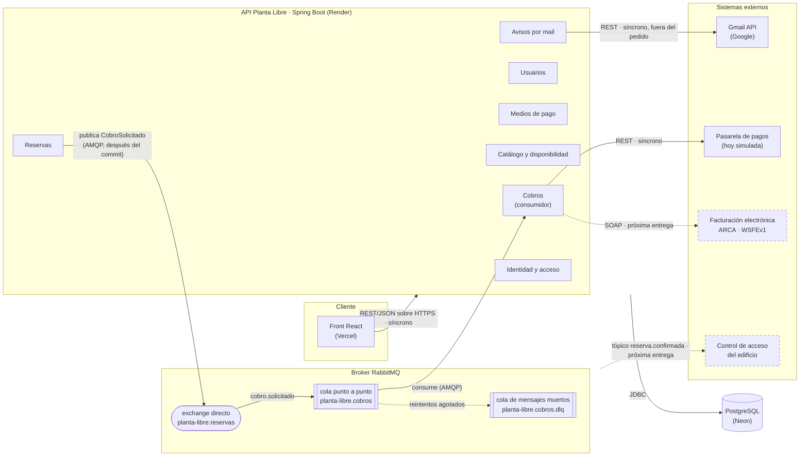
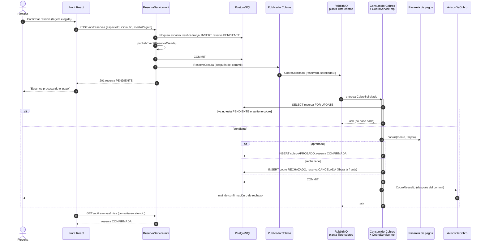

# Planta Libre — Arquitectura de integración

**Entrega parcial N.º 2 · Unidades IV y V**
Complementa al [documento técnico](DocumentoTecnico.md) y al [dominio de reservas](DominioReservas.md).

Este documento cubre los tres puntos del checkpoint:

1. el diagrama de arquitectura de integración (SOA): qué componentes internos y qué sistemas externos se conectan, y por qué canal;
2. la clasificación justificada de cada integración externa en síncrona (SOAP o REST) o asincrónica (cola o tópico);
3. el primer proceso de negocio asincrónico funcionando de punta a punta con un broker real: **cobro y confirmación de una reserva**, sobre una cola punto a punto de RabbitMQ.

---

## 1. Diagrama de arquitectura de integración



Las líneas punteadas son las integraciones previstas para la entrega obligatoria. El resto está implementado.

**Componentes internos.** La API sigue siendo un monolito modular (ver el documento técnico, sección 2). Cada componente expone su interfaz de servicio, y los que hablan con afuera lo hacen a través de un puerto propio:

| Componente | Puerto hacia afuera | Adaptador actual |
|---|---|---|
| Avisos por mail | `EmailService` | `SmtpEmailService` o `GmailApiEmailService` (Strategy) |
| Cobros | `PasarelaPagos` | `PasarelaPagosSimulada` |
| Reservas → Cobros | evento de dominio `ReservaCreada` | `PublicadorCobros` (RabbitMQ) |

Los servicios de negocio no conocen RabbitMQ: `ReservaServiceImpl` publica un evento de Spring y es el paquete `mensajeria` el que lo convierte en mensaje. Si mañana el broker cambia (ActiveMQ, SQS), se reemplaza ese paquete y nada más.

---

## 2. Clasificación de las integraciones

| Integración | Sentido | Canal | Tipo | Estado |
|---|---|---|---|---|
| Front React ↔ API | entrante | REST/JSON sobre HTTPS | Síncrona | Hecha |
| Reservas → Cobros | interna, entre componentes | Cola punto a punto (AMQP) | **Asincrónica** | **Hecha (este checkpoint)** |
| Cobros → Pasarela de pagos | saliente | REST/JSON | Síncrona, dentro del proceso asincrónico | Simulada |
| Avisos → Gmail API | saliente | REST/JSON sobre HTTPS (OAuth 2) | Síncrona, disparada fuera del pedido | Hecha |
| Cobros → Facturación electrónica ARCA | saliente | SOAP (WSFEv1, con WSDL) | Síncrona | Próxima entrega |
| Reserva confirmada → mail, control de acceso, auditoría | interna → varios | Tópico pub/sub | **Asincrónica** | Próxima entrega |

### Por qué cada una

**Front ↔ API: REST síncrono.** La persona está mirando la pantalla y necesita la respuesta para seguir: si la franja quedó tomada, la alternativa más cercana, el error de validación. Es pedido y respuesta, y REST/JSON es lo natural para un navegador.

**Cobro de la reserva: asincrónico, con cola punto a punto.** Es la decisión central de este checkpoint.

- *Por qué asincrónico.* Cobrar depende de un tercero que puede tardar o estar caído. Si el cobro corriera dentro del `POST /api/reservas`, una pasarela lenta dejaría a la persona esperando, y la transacción mantendría bloqueado el espacio todo ese tiempo, frenando a quien quiera reservar el mismo lugar. Separado, la reserva se guarda en milisegundos como `PENDIENTE` y el cobro llega unos segundos después. Si la pasarela está caída, el mensaje espera en la cola y se reintenta, sin perder la reserva.
- *Por qué cola y no tópico.* Cada pedido de cobro tiene que procesarse **una sola vez, por un solo consumidor**: si dos instancias de la API leyeran el mismo mensaje, se cobraría dos veces. Es el caso de libro del punto a punto. Con más instancias, la cola reparte los mensajes entre ellas (consumidores competidores) y el trabajo escala sin cambios.
- *Por qué la llamada a la pasarela es síncrona.* El consumidor necesita saber si el pago se aprobó para decidir el estado de la reserva. Los proveedores modernos (Mercado Pago, Stripe) exponen REST, así que el adaptador real será un cliente REST. Lo asincrónico es el proceso visto desde la persona, no cada llamada.

**Gmail API: REST síncrono, fuera del pedido.** Google ofrece el envío solamente como API REST. La llamada se hace en otro hilo (`@Async`) para que el tiempo de respuesta no revele si una cuenta existe y para que una falla del correo no rompa el flujo. Esto **no** es mensajería: si la aplicación se reinicia, un mail en vuelo se pierde. En la próxima entrega los avisos pasan a ser suscriptores de un tópico.

**Facturación electrónica: SOAP síncrono.** El web service de factura electrónica de ARCA (ex AFIP), WSFEv1, es SOAP con WSDL publicado. Es exactamente el sistema "legado" que pide el enunciado. Es síncrono porque la respuesta trae el CAE (código de autorización), sin el cual la factura no existe. Se va a invocar desde el proceso de cobro, ya fuera del pedido de la persona.

**Reserva confirmada: tópico pub/sub.** Cuando una reserva se confirma hay varios interesados independientes: avisar por mail, habilitar la tarjeta en el control de acceso del edificio y registrar la ocupación. Ninguno debería conocer a los otros, y agregar uno nuevo no debería tocar al publicador. Eso es un tópico: un mensaje, muchas copias.

---

## 3. Proceso asincrónico: cobro y confirmación de una reserva

### Qué pasa

1. La persona confirma la reserva y elige la tarjeta. `POST /api/reservas` valida, bloquea el espacio, guarda la reserva como `PENDIENTE` junto con la tarjeta elegida, y publica el evento de dominio `ReservaCreada`.
2. **Después del commit**, `PublicadorCobros` envía `CobroSolicitado` al exchange `planta-libre.reservas` con la clave `cobro.solicitado`. La API ya respondió `201`.
3. El broker enruta el mensaje a la cola durable `planta-libre.cobros`.
4. `ConsumidorCobros` lo recibe y llama a `CobroServiceImpl.procesar`, que en **una sola transacción**:
   - bloquea la fila de la reserva (`SELECT ... FOR UPDATE`);
   - si ya no está pendiente (la cancelaron o la confirmó un administrador) o ya tiene un cobro, no hace nada;
   - calcula el monto con el `Tarifario` (tarifa por hora del tipo de espacio, prorrateada por minuto);
   - cobra a la tarjeta elegida o, si no hay una, a la principal del cliente;
   - guarda el `Cobro` y deja la reserva `CONFIRMADA` si se aprobó, o `CANCELADA` si se rechazó, con lo que la franja queda libre otra vez.
5. Después de ese commit, `AvisosDeCobro` manda el mail: "Tu reserva está confirmada" con el monto cobrado, o "No pudimos cobrar tu reserva" con el motivo.
6. En el front, *Mis reservas* vuelve a consultar en silencio unas veces después de reservar, y la reserva pasa de *Pendiente* a *Confirmada* sin recargar la página.

### Diagrama de secuencia



### Topología del broker

La declara la aplicación al arrancar (`MensajeriaConfig`). RabbitMQ crea lo que falte.

| Objeto | Nombre | Para qué |
|---|---|---|
| Exchange directo | `planta-libre.reservas` | Entrada del dominio de reservas. La clave `cobro.solicitado` lleva a la cola de cobros. |
| Cola durable | `planta-libre.cobros` | Punto a punto. Sobrevive a un reinicio del broker. Los rechazos van al DLX. |
| Exchange directo | `planta-libre.dlx` | Exchange de mensajes muertos. |
| Cola durable | `planta-libre.cobros.dlq` | Mensajes que agotaron los reintentos, para revisarlos a mano. |

El mensaje viaja en JSON y lleva solamente el id de la reserva. El consumidor lee el estado actual de la base, así que un mensaje que llega tarde nunca actúa sobre datos viejos:

```json
{ "reservaId": 42, "solicitadoEl": "2026-10-19T12:03:10.512Z" }
```

### Qué pasa cuando algo falla

| Falla | Comportamiento |
|---|---|
| La reserva no se pudo guardar (franja tomada, validación) | La transacción hace rollback y el evento nunca sale: el publicador escucha **después del commit**. No hay mensaje para una reserva que no existe. |
| La pasarela rechaza el pago | No es un error: se guarda el cobro `RECHAZADO`, la reserva queda `CANCELADA`, la franja se libera y llega el mail. |
| La pasarela falla técnicamente (timeout, caída) | `procesar` lanza la excepción y **toda** la transacción hace rollback: no queda cobro guardado y la reserva sigue `PENDIENTE`. El listener lo intenta 3 veces en total, esperando 2 s y después 4 s. Si sigue fallando, el mensaje va a `planta-libre.cobros.dlq`. |
| El mismo mensaje llega dos veces | La segunda vez la reserva ya no está pendiente y además `cobros.reserva_id` es `UNIQUE`: no se cobra dos veces. |
| La persona cancela mientras se está cobrando | Cancelar y cobrar bloquean la misma fila, así que se ejecutan uno después del otro. Si gana la cancelación, el consumidor la ve `CANCELADA` y no cobra. |
| El broker está caído cuando se crea la reserva | La reserva ya está guardada. El error queda en el log y la reserva sigue `PENDIENTE`; un administrador la puede confirmar a mano. Es el límite conocido de publicar después del commit (ver sección 5). |

### Tarifas

`app.tarifas.por-hora` en `application.yml`. La aplicación no arranca si falta la tarifa de un tipo de espacio.

| Tipo | Por hora |
|---|---|
| Cubículo | $ 3.500 |
| Sala de reuniones | $ 9.000 |
| Sala de presentaciones | $ 14.000 |
| Sala de conferencias | $ 22.000 |

### Datos

La migración `V13__create_cobros.sql` agrega `reservas.medio_pago_id` (la tarjeta elegida) y la tabla `cobros` (reserva, tarjeta, monto, estado, referencia del proveedor, motivo de rechazo y fecha). Si un administrador borra una reserva, el cobro queda registrado con `reserva_id` en `NULL`.

---

## 4. Cómo correrlo y qué mostrar

```bash
docker compose up --build
```

Levanta todo con el cobro asincrónico activado: base, broker, backend y front (ver el [README](../README.md)). La consola de RabbitMQ queda en http://localhost:15672 con el usuario `planta-libre-admin`; su contraseña se lee con `docker compose exec back cat /secretos/rabbitmq_admin_password`. La aplicación web queda en http://localhost:8088.

Recorrido de demo, con las tarjetas de prueba de la pasarela simulada (las mismas que usan los entornos sandbox de los proveedores):

| Tarjeta | Resultado |
|---|---|
| cualquier tarjeta válida, por ejemplo `4242 4242 4242 4242` | Aprobada: la reserva pasa de *Pendiente* a *Confirmada* en unos 2 segundos. |
| `4000 0000 0000 0002` | Rechazada: la reserva queda *Cancelada*, el horario se libera y llega el mail de rechazo. |
| `4000 0000 0000 0119` | Falla técnica: 3 intentos en el log, la reserva sigue *Pendiente* y el mensaje aparece en `planta-libre.cobros.dlq`. |

En la consola se ven el exchange, la cola, el mensaje entrando y saliendo y, con la última tarjeta, el mensaje en la DLQ.

Sin `MENSAJERIA_HABILITADA=true` la aplicación arranca igual que antes, sin necesitar el broker: las reservas quedan pendientes hasta que las confirma un administrador. En Render queda apagada hasta configurar `RABBITMQ_URL` con un broker en la nube, por ejemplo la URL `amqps://` de una instancia gratuita de CloudAMQP.

---

## 5. Límites conocidos y próximos pasos

- **Publicación después del commit, sin outbox.** Si la aplicación se cae justo entre el commit de la reserva y el envío del mensaje, la reserva queda `PENDIENTE` sin cobro. Para la entrega obligatoria, la versión robusta es un *transactional outbox*: guardar el mensaje en una tabla dentro de la misma transacción y publicarlo desde ahí.
- **La pasarela es simulada.** El puerto `PasarelaPagos` ya está separado. El adaptador REST real se agrega sin tocar `CobroServiceImpl`.
- **Reintegros sincrónicos.** Al cancelar, el reintegro se pide a la pasarela dentro de la misma transacción (ver la política de cancelación en [DominioReservas.md](DominioReservas.md)). Con un proveedor real conviene pasarlo también a una cola.
- **Para la entrega obligatoria:** el tópico `reserva.confirmada` con sus suscriptores, el servicio SOAP de facturación con su WSDL, el servicio REST hacia el partner de pagos, y el flujo crítico "reservar → cobrar → confirmar" con transacciones declarativas explicado ante una falla a mitad de camino. Este proceso ya cubre buena parte de ese último punto.
